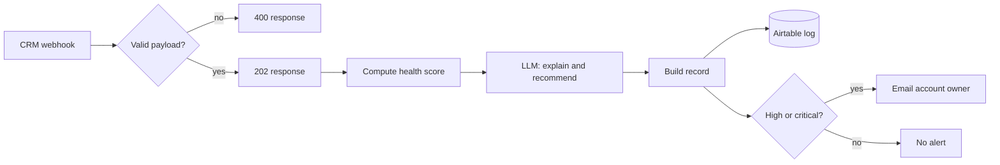
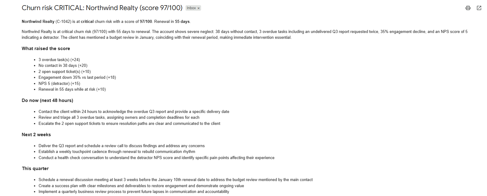
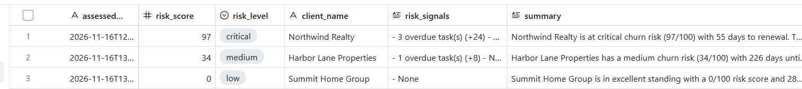
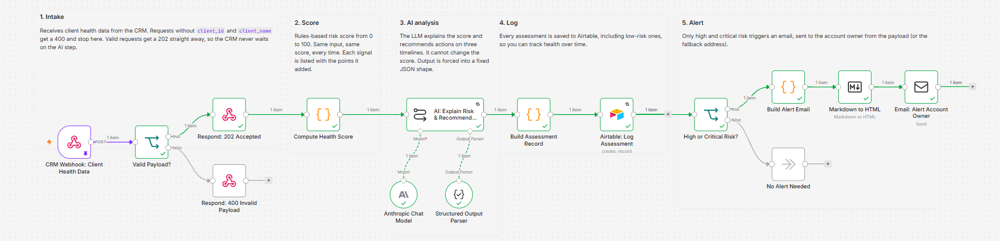

# AI Customer Churn Predictor

An n8n workflow that scores each client's churn risk with transparent rules, then uses an LLM to explain the risk and recommend actions. Every assessment is logged to Airtable. High and critical risk clients trigger an email alert to the account owner.

## Problem

Churn rarely comes out of nowhere. Overdue deliverables, slow replies and falling usage show up weeks before a client leaves, but they sit in different places and nobody connects them until the renewal call goes badly.

## Why it's built this way

Most AI churn tools hand raw data to a model and trust whatever comes back. This workflow splits the job:

- **Rules decide the score.** Same input, same score, every time. Every point is traceable to a signal.
- **The LLM explains and recommends.** It gets the score and the signals behind it, and it can't change them.

The result is a score you can defend to a client, plus action plans written for the specific situation.

## How it works



1. **Intake.** The CRM posts client health data to the webhook. Payloads missing `client_id` or `client_name` get a 400. Valid payloads get a 202 immediately, so the CRM never waits on the AI step.
2. **Score.** A Code node calculates a risk score from 0 to 100.
3. **AI analysis.** An LLM chain with a structured output parser returns a summary, the main risk driver, and actions on three timelines.
4. **Log.** Every assessment goes to Airtable, including low-risk ones, so health can be tracked over time.
5. **Alert.** High and critical risk sends an HTML email to the account owner.

## Scoring rules

| Signal | Points |
|---|---|
| Overdue tasks | 8 per task, max 30 |
| Days since last contact | 15 to 30 days: 10. Over 30 days: 20 |
| Open support tickets | 5 per ticket, max 20 |
| Engagement trend (negative) | 0.5 per % drop, max 25 |
| NPS | 0 to 6: 15. 7 to 8: 5 |
| Renewal within 60 days while already at 30+ | 10 |

The score is capped at 100.

| Score | Risk level | Alert |
|---|---|---|
| 0 to 29 | low | No |
| 30 to 49 | medium | No |
| 50 to 69 | high | Yes |
| 70 to 100 | critical | Yes |

Weights live in the **Compute Health Score** node. Tune them to the client's business.

## Webhook payload

```json
{
  "client_id": "C-1042",
  "client_name": "Northwind Realty",
  "account_owner_email": "owner@yourcompany.com",
  "contract_value": 18000,
  "renewal_date": "2027-01-10",
  "days_since_last_contact": 38,
  "overdue_tasks": 3,
  "open_support_tickets": 2,
  "engagement_trend_pct": -35,
  "nps_score": 5,
  "recent_notes": ["Client asked twice for the Q3 report, still not delivered"]
}
```

Only `client_id` and `client_name` are required. Missing signals score as zero. Extra fields are passed to the LLM as context.

## Setup

1. Import `workflow.json` into n8n (Workflows > Import from File).
2. Add credentials for **Anthropic**, **Airtable** and **SMTP**.
3. Create an Airtable table with the fields below, then set the base and table IDs in **Airtable: Log Assessment**.
4. In **Email: Alert Account Owner**, set the From address and the fallback To address.
5. Activate the workflow and point your CRM (or a scheduled export job) at the production webhook URL.

### Airtable fields

| Field | Type |
|---|---|
| assessed_at | Date (with time) |
| client_id | Single line text |
| client_name | Single line text |
| account_owner_email | Email |
| risk_score | Number |
| risk_level | Single select: low, medium, high, critical |
| days_to_renewal | Number |
| risk_signals | Long text |
| summary | Long text |
| primary_risk_driver | Long text |
| actions_immediate | Long text |
| actions_short_term | Long text |
| actions_long_term | Long text |

Field names must match exactly. The Airtable node maps them automatically.

## Example output

Alert email for a critical-risk client:



Assessments logged in Airtable:



Successful run of the critical-risk path:



## Testing

Sample payloads are in `samples/`: one each for critical, medium and low risk, plus `invalid.json`, which should be rejected with a 400.

```bash
curl -X POST https://your-n8n-host/webhook-test/churn-predictor \
  -H "Content-Type: application/json" \
  -d @samples/critical-risk.json
```

## Customizing

- **Signals.** Add new signals in the scoring node, such as payment delays, seat reductions or a champion leaving. The LLM picks them up automatically through the signal list.
- **Model.** Defaults to Claude Sonnet 4.5 (`claude-sonnet-4-5`). Any chat model supported by n8n works. Note: on n8n 2.32, the Anthropic node is not compatible with the newest Claude 5.x models (the API rejects its thinking setting). Update n8n before switching to them.
- **Destination.** Swap Airtable for HubSpot, Pipedrive or a CRM task, and email for Slack or Teams.
- **Trigger.** Replace the webhook with a Schedule Trigger plus a CRM query to scan every client daily.
