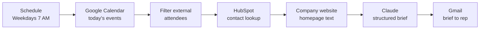

# Automated Sales Meeting Prep

An n8n workflow that researches every external meeting on a sales rep's calendar and emails them a one-page prep brief before the day starts.

## Problem

Sales reps walk into calls without context. Checking the CRM, the prospect's website and past notes takes 10 to 15 minutes per meeting, and on busy days it gets skipped.

## How it works

1. **Find meetings.** Pulls today's calendar events and keeps only meetings with at least one attendee outside the company domain.
2. **Research.** Looks up the attendee in HubSpot by email and fetches the company homepage. Personal email domains (Gmail, GMX, etc.) skip the website step.
3. **Generate.** Sends meeting details, CRM data and website text to Claude (Anthropic) and asks for a fixed JSON structure.
4. **Deliver.** Formats the brief as HTML and emails it to the rep.

Each brief contains: summary, company overview, person overview, relationship history, talking points, questions to ask, and risks.

## Reliability

- CRM lookup and website fetch continue on error. A missing record or dead site produces a thinner brief, not a failed run.
- HubSpot and Claude calls retry up to 3 times.
- The JSON parser extracts the object even if the model adds text around it. If parsing fails, the email still goes out with a note to check the logs.
- The prompt tells the model to use only provided data and say "unknown" instead of guessing.
- Website text is capped (default 4,000 characters) to keep token cost predictable.

## Setup

1. Import `workflow.json` into n8n (Workflows > Import from File).
2. Open the **Config** node and set:

| Field | Example | Purpose |
|---|---|---|
| `internalDomain` | `yourcompany.com` | Attendees on this domain are ignored |
| `repEmail` | `you@yourcompany.com` | Where the brief is sent |
| `personalEmailDomains` | `gmail.com,gmx.de,...` | Domains with no company website |
| `llmModel` | `claude-haiku-4-5` | Model used for the brief |
| `maxWebsiteChars` | `4000` | Website text limit |
| `timezone` | `Europe/Berlin` | Time shown in the email |

3. Connect credentials:
   - Google Calendar OAuth2 (then select your calendar in **Get Today's Meetings**)
   - HubSpot service key with the `crm.objects.contacts.read` scope (Development > Keys > Service keys)
   - Anthropic API key
   - Gmail OAuth2
4. Run once manually, check the email, then activate.

## Testing

Tested end to end on self-hosted n8n with 8 calendar events and 12 test contacts in HubSpot:

| Scenario | Result |
|---|---|
| Known CRM contact (lead, customer, unqualified) | Brief uses CRM stage and lead status |
| Contact not in CRM | Brief marks them as a new contact |
| Personal email (GMX) | Website step skipped |
| Dead website | Brief still delivered, company marked unknown |
| Internal meeting, no guests | Filtered out, no email |
| Google Meet link | Join link included in the email |

## Known limitations

- Only the first external attendee is researched. On multi-company meetings this may not be the main contact.
- Many company homepages render with JavaScript or block bots, so a plain fetch returns little text. A scraper (Apify, Jina Reader) would improve company research.
- Sending many HubSpot searches at once can hit the API rate limit. Enable batching on the HubSpot node for large calendars.

## Possible extensions

- Add LinkedIn enrichment (Apify or Clay) for the attendee
- Pull recent deal notes and open tickets from HubSpot
- Post the brief to Slack instead of email
- Trigger 30 minutes before each meeting instead of once per morning

## Screenshot

